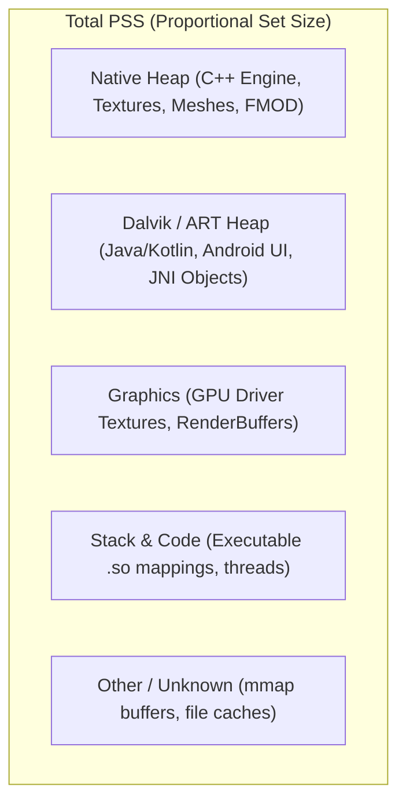

# Memory Profiling & Crash Analysis in Android Logcat

This reference details the mechanics of Android process memory (PSS, RSS, VSS), low-memory kills (LMK), and native crash symbolication for IL2CPP.

---

## 1. Android Memory Anatomy

When inspecting the Memory Viewer in Android Logcat (`Window > Analysis > Android Logcat > Memory`), five primary metrics are tracked:



### Key Thresholds
- **PSS (Proportional Set Size)**: The true memory load charged against the application by the Linux kernel. If two processes share a 10MB library, each process is charged 5MB PSS.
- **Low Memory Killer (LMK)**: The Android kernel daemon kills background and foreground processes when free RAM dips below device `minfree` thresholds.
- **`oom_adj` Score**: Ranging from -1000 to 1000. Foreground active games have score `0`. When minimized, the score rises, making the process prime candidate for eviction.

---

## 2. Low-Memory Simulation & Handling

### Simulating Trim Memory Events
In Logcat Memory window, select **Send Trim Memory Usage**:
- `TRIM_MEMORY_RUNNING_MODERATE`: Device is under moderate memory pressure.
- `TRIM_MEMORY_RUNNING_LOW`: Device is running critically low on memory.
- `TRIM_MEMORY_RUNNING_CRITICAL`: Foreground app must immediately release unneeded resources.

### Game Code Handler
```csharp
using UnityEngine;
using System;

public class MemoryPressureHandler : MonoBehaviour
{
    private void OnEnable()
    {
        Application.lowMemory += OnLowMemory;
    }

    private void OnDisable()
    {
        Application.lowMemory -= OnLowMemory;
    }

    private void OnLowMemory()
    {
        Debug.LogWarning("[MemoryPressureHandler] Low memory signal received! Purging caches...");
        // 1. Unload unused assets from memory
        Resources.UnloadUnusedAssets();

        // 2. Clear custom sprite/audio caches
        GC.Collect();
    }
}
```

---

## 3. Native Crash Symbolication (IL2CPP)

### Generating Symbols
In Unity Build Settings (`File > Build Settings > Android`):
1. Set **Scripting Backend** to `IL2CPP`.
2. Check **Create symbols.zip** (or select `Public` / `Debugging`).
3. Build the project. Unity outputs `<ProjectName>-<version>-v8a.symbols.zip`.

### Symbolication Workflow in Logcat
1. Open `Window > Analysis > Android Logcat > Stacktrace`.
2. Paste the crash log or let Logcat capture it automatically from the log stream:
   ```text
   backtrace:
         #00 pc 00000000004f21a4  /data/app/.../lib/arm64/libil2cpp.so
         #01 pc 000000000032c810  /data/app/.../lib/arm64/libil2cpp.so
         #02 pc 00000000008412e0  /data/app/.../lib/arm64/libunity.so
   ```
3. Set **Symbols Path** to the folder containing `symbols.zip` or the unzipped `libil2cpp.so.debug`.
4. Click **Symbolicate**.
5. Logcat invokes `addr2line` / `llvm-symbolizer` from Android NDK and resolves offsets:
   ```text
   #00 PlayerController.Update() at D:/Unity Projects/mini_game/Assets/Scripts/PlayerController.cs:48
   #01 PlayerController.Move() at D:/Unity Projects/mini_game/Assets/Scripts/PlayerController.cs:92
   ```
