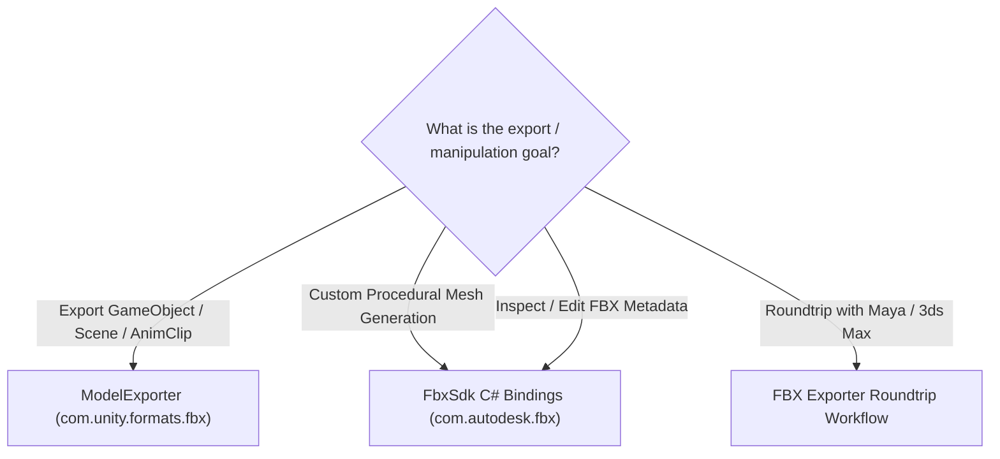

# Autodesk FBX Skill

This skill guides programmatically authoring, exporting, importing, and validating FBX files in Unity using the low-level **Autodesk FBX SDK C# Bindings** (`com.autodesk.fbx`) and high-level **Unity FBX Exporter** (`com.unity.formats.fbx`).

## Quick Reference & Entry Points

| Tool / Class | Package | Core Purpose |
| :--- | :--- | :--- |
| **`ModelExporter`** | `UnityEditor.Formats.Fbx.Exporter` | High-level C# API to export GameObjects, Meshes, and AnimClips with automated material mapping. |
| **`FbxManager`** | `Autodesk.Fbx` | Core native FBX SDK context. Controls memory allocation and must be explicitly destroyed via `Destroy()`. |
| **`FbxScene`** | `Autodesk.Fbx` | The root document holding nodes, materials, animations, and global settings. |
| **`FbxNode` & `FbxMesh`** | `Autodesk.Fbx` | Scene hierarchy nodes, control points (vertices), polygon vertices (indices), and normal/UV layers. |
| **`FbxAnimStack` & `FbxAnimLayer`** | `Autodesk.Fbx` | Animation containers and keyframe curve tracks (`FbxAnimCurve`). |

---

## High-Level vs Low-Level Workflow Selection



### High-Level Exporting with `ModelExporter`
```csharp
#if UNITY_EDITOR
using UnityEditor;
using UnityEditor.Formats.Fbx.Exporter;
using UnityEngine;

public static class ExportUtility
{
    public static void ExportSelectedObject(GameObject targetGo, string outputPath)
    {
        // Export GameObject hierarchy with default settings (Binary FBX, mesh, materials)
        ModelExporter.ExportObject(outputPath, targetGo);
        Debug.Log($"Successfully exported {targetGo.name} to {outputPath}");
    }
}
#endif
```

### Low-Level Procedural Mesh Creation with `FbxManager`
```csharp
using Autodesk.Fbx;

public static class ProceduralFbxBuilder
{
    public static void CreateBoxScene(string filePath)
    {
        // 1. Initialize SDK Manager
        using (var sdkManager = FbxManager.Create())
        {
            // 2. Configure IO settings
            var ios = FbxIOSettings.Create(sdkManager, Globals.IOSROOT);
            sdkManager.SetIOSettings(ios);

            // 3. Create Scene
            var scene = FbxScene.Create(sdkManager, "ProceduralScene");

            // 4. Create Node & Mesh
            var rootNode = scene.GetRootNode();
            var meshNode = FbxNode.Create(sdkManager, "MeshNode");
            var mesh = FbxMesh.Create(sdkManager, "CustomMesh");

            // Define control points (vertices)
            mesh.InitControlPoints(4);
            mesh.SetControlPointAt(new FbxVector4(0, 0, 0), 0);
            mesh.SetControlPointAt(new FbxVector4(1, 0, 0), 1);
            mesh.SetControlPointAt(new FbxVector4(1, 1, 0), 2);
            mesh.SetControlPointAt(new FbxVector4(0, 1, 0), 3);

            // Define polygon (quad)
            mesh.BeginPolygon();
            mesh.AddPolygon(0);
            mesh.AddPolygon(1);
            mesh.AddPolygon(2);
            mesh.AddPolygon(3);
            mesh.EndPolygon();

            meshNode.SetNodeAttribute(mesh);
            rootNode.AddChild(meshNode);

            // 5. Export to disk
            var exporter = FbxExporter.Create(sdkManager, "");
            exporter.Initialize(filePath, -1, sdkManager.GetIOSettings());
            exporter.Export(scene);
            exporter.Destroy();
        } // sdkManager.Destroy() called automatically via IDisposable / using
    }
}
```

---

## Detailed References
- [FBX SDK C# Bindings & Memory Architecture](file:///d:/Unity%20Projects/mini_game/.agents/skills/autodesk-fbx/references/fbx-sdk-bindings.md)
- [ModelExporter & DCC Roundtripping Workflows](file:///d:/Unity%20Projects/mini_game/.agents/skills/autodesk-fbx/references/model-exporter-workflows.md)
