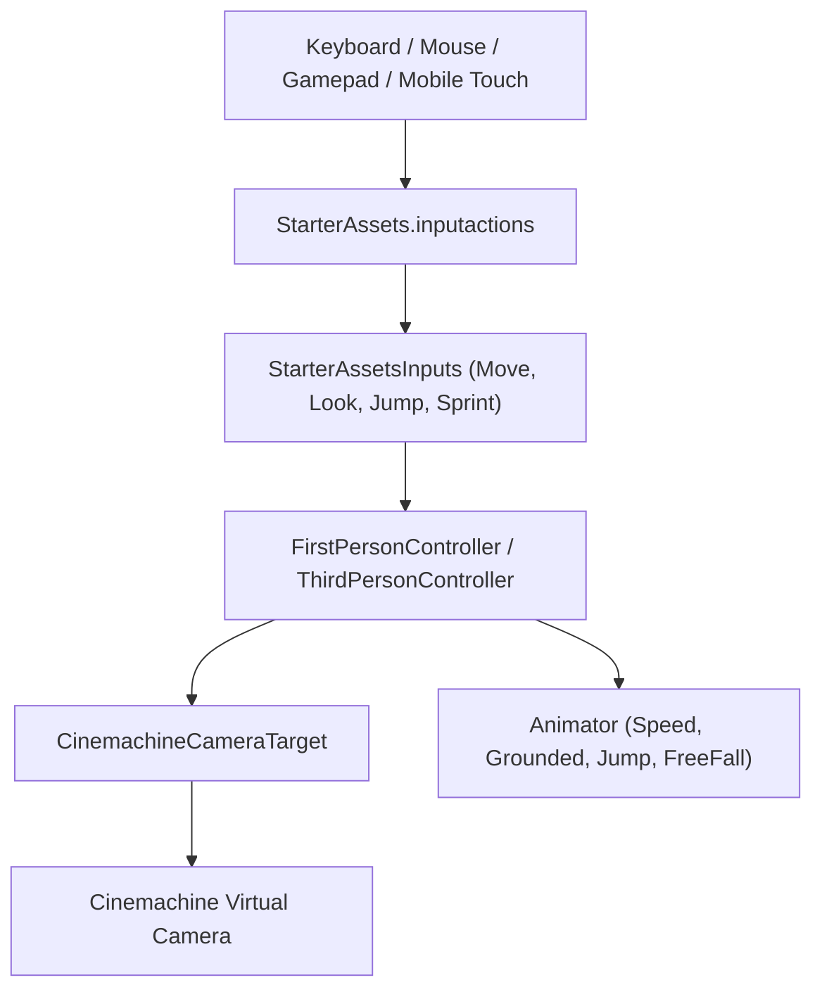

# Unity Starter Assets Character Controllers Skill

This skill guides setting up, customizing, and tuning Unity's official **Starter Assets** (`StarterAssets` namespace) for First-Person and Third-Person player locomotion.

## Core Architecture & Rationale

Unity Starter Assets provide ready-to-use production controller rigs built on:
- Unity **CharacterController** component.
- The modern **New Input System** (`com.unity.inputsystem`).
- **Cinemachine** virtual cameras for look/orbit controls.
- Mechanim **Blend Trees** (Idle, Walk, Run, Jump, Fall).



---

## 1. Third-Person Controller Rig Setup

1. Instantiate prefab `Assets/Starter Assets/ThirdPersonController/Prefabs/NestedParent_Armature_ThirdPersonController.prefab`.
2. Configure movement speeds in inspector:
   - `MoveSpeed`: `4.0`
   - `SprintSpeed`: `7.0`
   - `SpeedChangeRate`: `10.0`
   - `JumpHeight`: `1.5`
   - `Gravity`: `-15.0`
3. Ensure a Cinemachine Virtual Camera (or Unity 6 `CinemachineCamera`) follows and looks at the `PlayerCameraRoot` transform.

---

## 2. First-Person Controller Rig Setup

1. Instantiate prefab `Assets/Starter Assets/FirstPersonController/Prefabs/NestedParent_FirstPersonController.prefab`.
2. Adjust look sensitivity and camera clamp angles:
   - `RotationSpeed`: `1.0`
   - `TopClamp`: `90.0°`
   - `BottomClamp`: `-90.0°`

---

## 3. Mobile Input Integration with `UICanvasControllerInput`

For mobile builds with on-screen joysticks:
- Use `UICanvasControllerInput` to route virtual joystick vectors into `StarterAssetsInputs`:
```csharp
using UnityEngine;
using StarterAssets;

public class MobileJoystickBridge : MonoBehaviour
{
    public StarterAssetsInputs TargetInputs;

    public void OnVirtualJoystickMoved(Vector2 direction)
    {
        TargetInputs.MoveInput(direction);
    }

    public void OnVirtualJumpPressed(bool isPressed)
    {
        TargetInputs.JumpInput(isPressed);
    }
}
```

---

## Detailed References
- [First-Person & Third-Person Controller Mechanics](file:///d:/Unity%20Projects/mini_game/.agents/skills/character-controllers-starter-assets/references/first-person-third-person-controllers.md)
- [Cinemachine & Input System Integration](file:///d:/Unity%20Projects/mini_game/.agents/skills/character-controllers-starter-assets/references/cinemachine-and-input-integration.md)
