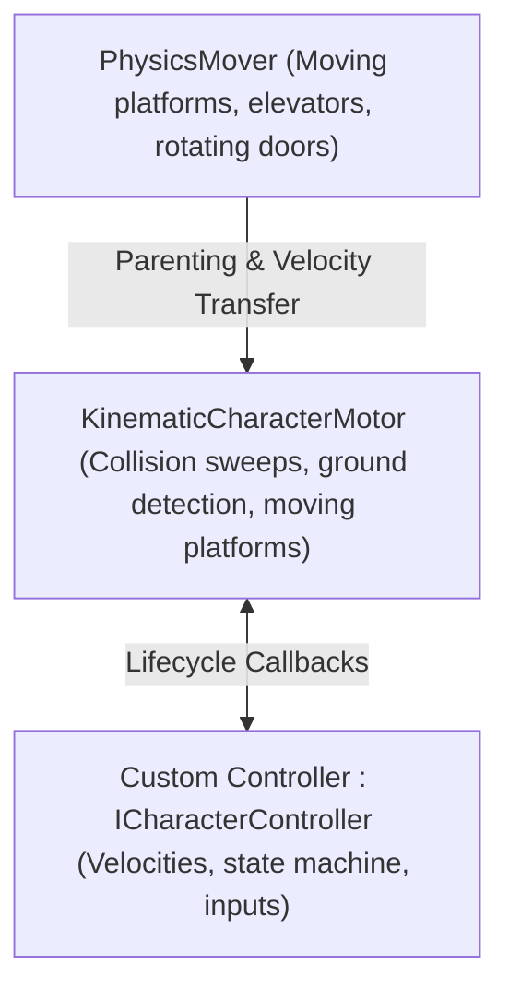

# Kinematic Character Controller (KCC) Skill

This skill guides the implementation of responsive, glitch-free character movement using **Kinematic Character Controller** (`KinematicCharacterController` by Philippe St-Amand).

## Core Concepts & Architecture

Unlike Unity's built-in `CharacterController` or dynamic `Rigidbody`, KCC is a **kinematic simulation** driven by capsule cast sweeps and collision iterations, providing complete control over velocity, gravity, slope sliding, and moving platform parenting.



---

## 1. Minimal Implementation of `ICharacterController`

Every KCC character requires a `KinematicCharacterMotor` and a script implementing `ICharacterController`:

```csharp
using UnityEngine;
using KinematicCharacterController;

[RequireComponent(typeof(KinematicCharacterMotor))]
public class BasicKCCPlayer : MonoBehaviour, ICharacterController
{
    public KinematicCharacterMotor Motor;

    [Header("Movement")]
    public float MaxSpeed = 8f;
    public float Acceleration = 30f;
    public float JumpSpeed = 10f;
    public Vector3 Gravity = new Vector3(0, -20f, 0);

    private Vector3 _moveInputVector;
    private bool _jumpRequested;

    private void Awake()
    {
        Motor = GetComponent<KinematicCharacterMotor>();
        Motor.CharacterController = this;
    }

    public void SetInputs(Vector3 moveInput, bool jump)
    {
        _moveInputVector = moveInput;
        if (jump) _jumpRequested = true;
    }

    public void UpdateRotation(ref Quaternion currentRotation, float deltaTime)
    {
        // Handle rotation towards movement direction or camera forward
        if (_moveInputVector.sqrMagnitude > 0.001f)
        {
            Vector3 lookDir = Vector3.ProjectOnPlane(_moveInputVector, Motor.CharacterUp).normalized;
            currentRotation = Quaternion.LookRotation(lookDir, Motor.CharacterUp);
        }
    }

    public void UpdateVelocity(ref Vector3 currentVelocity, float deltaTime)
    {
        // 1. Ground movement vs Air movement
        if (Motor.GroundingStatus.IsStableOnGround)
        {
            Vector3 targetVel = _moveInputVector * MaxSpeed;
            // Project movement onto ground slope normal
            targetVel = Motor.GetDirectionTangentToGround(targetVel, Motor.GroundingStatus.GroundNormal) * targetVel.magnitude;
            currentVelocity = Vector3.MoveTowards(currentVelocity, targetVel, Acceleration * deltaTime);

            // Jump
            if (_jumpRequested)
            {
                currentVelocity += Motor.CharacterUp * JumpSpeed;
                Motor.ForceUnground();
                _jumpRequested = false;
            }
        }
        else
        {
            // Apply gravity and air drag
            currentVelocity += Gravity * deltaTime;
        }
    }

    public void BeforeCharacterUpdate(float deltaTime) { }
    public void AfterCharacterUpdate(float deltaTime) { }
    public void PostGroundingUpdate(float deltaTime) { }
    public bool IsColliderValidForCollisions(Collider coll) => true;
    public void OnGroundHit(Collider hitCollider, Vector3 hitNormal, Vector3 hitPoint, ref HitStabilityReport hitStabilityReport) { }
    public void OnMovementHit(Collider hitCollider, Vector3 hitNormal, Vector3 hitPoint, ref HitStabilityReport hitStabilityReport) { }
    public void ProcessHitStabilityReport(Collider hitCollider, Vector3 hitNormal, Vector3 hitPoint, Vector3 atCharacterPosition, Quaternion atCharacterRotation, ref HitStabilityReport hitStabilityReport) { }
    public void OnDiscreteCollisionDetected(Collider hitCollider) { }
}
```

---

## 2. Moving Platforms with `PhysicsMover`

To create elevators, conveyor belts, or rotating platforms that carry characters seamlessly:
1. Attach `PhysicsMover` component to the platform GameObject.
2. Implement `IMoverController` to dictate target position and rotation per physics tick:

```csharp
using UnityEngine;
using KinematicCharacterController;

public class OscillatorPlatform : MonoBehaviour, IMoverController
{
    public PhysicsMover Mover;
    public Vector3 TravelAxis = new Vector3(0, 5, 0);
    public float Frequency = 1f;

    private Vector3 _startPosition;

    private void Awake()
    {
        Mover = GetComponent<PhysicsMover>();
        Mover.MoverController = this;
        _startPosition = transform.position;
    }

    public void UpdateMovement(out Vector3 goalPosition, out Quaternion goalRotation, float deltaTime)
    {
        float offset = Mathf.Sin(Time.time * Frequency * Mathf.PI * 2f);
        goalPosition = _startPosition + (TravelAxis * offset);
        goalRotation = transform.rotation;
    }
}
```

---

## Detailed References
- [KCC Motor Configuration & Character API](file:///d:/Unity%20Projects/mini_game/.agents/skills/kinematic-character-controller/references/kcc-motor-and-character-api.md)
- [Custom Movement States: Crouching, Swimming, Sliding & Ladders](file:///d:/Unity%20Projects/mini_game/.agents/skills/kinematic-character-controller/references/custom-movement-states.md)
