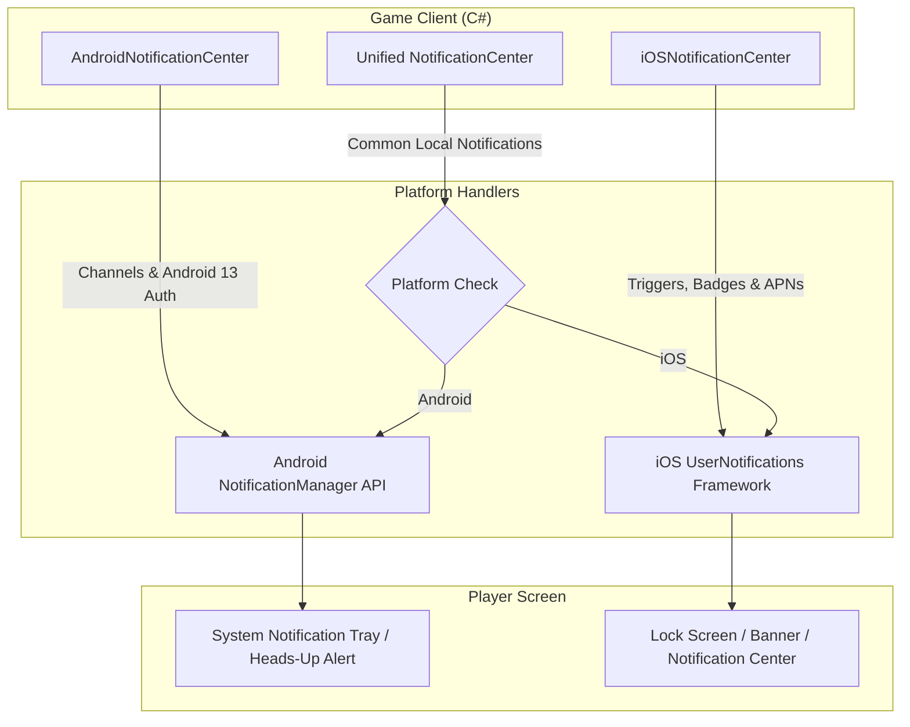

# Mobile Notifications (iOS & Android) Guide

Implement, schedule, and manage local push notifications on Android and iOS using Unity's official **Mobile Notifications** package (`com.unity.mobile.notifications`).

---

## 1. System Architecture



### The 3 API Surface Tiers:
1. **Unified API (`Unity.Notifications.NotificationCenter`)**: The recommended cross-platform API for scheduling standard local notifications, handling permissions, and querying responded notifications without platform-specific `#if` preprocessors.
2. **Android Specific (`Unity.Notifications.Android.AndroidNotificationCenter`)**: Required for creating Android 8.0+ notification channels, configuring importance levels, custom small/large icons, and setting device reboot alarms.
3. **iOS Specific (`Unity.Notifications.iOS.iOSNotificationCenter`)**: Required for calendar/location triggers, app icon badges, interactive notification actions, category groupings, and APNs remote token retrieval.

---

## 2. Technical References & Deep-Dives

Consult the specialized technical guides:

- [references/unified-notifications-api.md](references/unified-notifications-api.md) — Unified cross-platform workflow: `NotificationCenter.Initialize`, `NotificationCenter.RequestPermission`, `NotificationDateTimeSchedule`, `NotificationIntervalSchedule`, and handling app launch callbacks.
- [references/android-notifications-guide.md](references/android-notifications-guide.md) — Android channels (`AndroidNotificationChannel`), importance levels, custom small/large icons, sound setup, and Android 13+ (`POST_NOTIFICATIONS`) runtime permissions.
- [references/ios-notifications-guide.md](references/ios-notifications-guide.md) — iOS triggers (`iOSNotificationTimeIntervalTrigger`, `iOSNotificationCalendarTrigger`), presentation options, badge clearing, and notification actions.
- [references/retention-notification-recipes.md](references/retention-notification-recipes.md) — Battle-tested mobile game notification patterns (Stamina/Energy refilled, Daily rewards, Timed chest unlock, PvP raid alert, and Inactivity re-engagement).

---

## 3. Fast Implementation Checklist

### Step 1: Initialize Notification Center & Android Channels
```csharp
using Unity.Notifications;

var args = NotificationCenterArgs.Default;
args.AndroidChannelId = "game_alerts";
args.AndroidChannelName = "Game Alerts";
args.AndroidChannelDescription = "Alerts for energy refills and daily rewards.";
NotificationCenter.Initialize(args);
```

### Step 2: Request User Permission (Android 13+ & iOS)
```csharp
using System.Collections;
using Unity.Notifications;
using UnityEngine;

public IEnumerator RequestNotificationPermission()
{
    var request = NotificationCenter.RequestPermission();
    if (request.Status == NotificationsPermissionStatus.RequestPending)
        yield return request;

    Debug.Log($"Notification permission status: {request.Status}");
}
```

### Step 3: Schedule a Notification (e.g. Energy Full in 2 Hours)
```csharp
var notification = new Notification
{
    Identifier = 101, // Unique ID to update or cancel later
    Title = "Energy Restored! ⚡",
    Text = "Your stamina is full. Jump back into the battle!"
};

// Schedule 2 hours from now
var schedule = new NotificationIntervalSchedule(System.TimeSpan.FromHours(2));
NotificationCenter.ScheduleNotification(notification, schedule);
```

### Step 4: Clear Notifications on App Open
```csharp
// When player opens the game, clear delivered alerts so the tray stays tidy:
NotificationCenter.CancelAllDeliveredNotifications();
```

---

## 4. Anti-Hallucination & Platform Traps

| Pitfall | Why It Fails | Correct Architecture |
|---|---|---|
| **No Android Channel on Android 8+ (API 26+)** | Notifications will silently fail to display without an exception. | Always create and register an `AndroidNotificationChannel` before posting notifications on Android. |
| **Omitting Android 13+ Permission** | Android 13 (API 33+) blocks notifications unless `POST_NOTIFICATIONS` is granted. | Call `NotificationCenter.RequestPermission()` on startup or before scheduling the first alert. |
| **Not Resetting iOS Badge Count** | iOS app icon badge stays stuck with numbers even after the user plays. | Set `iOSNotificationCenter.ApplicationBadge = 0;` or clear delivered notifications on startup. |
| **Using Hardcoded Negative Notification IDs** | Negative integers can conflict with internal system IDs. | Use positive integer IDs (e.g., 1000+) or save the auto-generated ID returned by `ScheduleNotification`. |
| **Spamming Notifications** | Users will disable notification permissions or uninstall the app if spammed. | Cap local notifications to meaningful gameplay milestones (stamina full, building upgraded, daily reset). |
