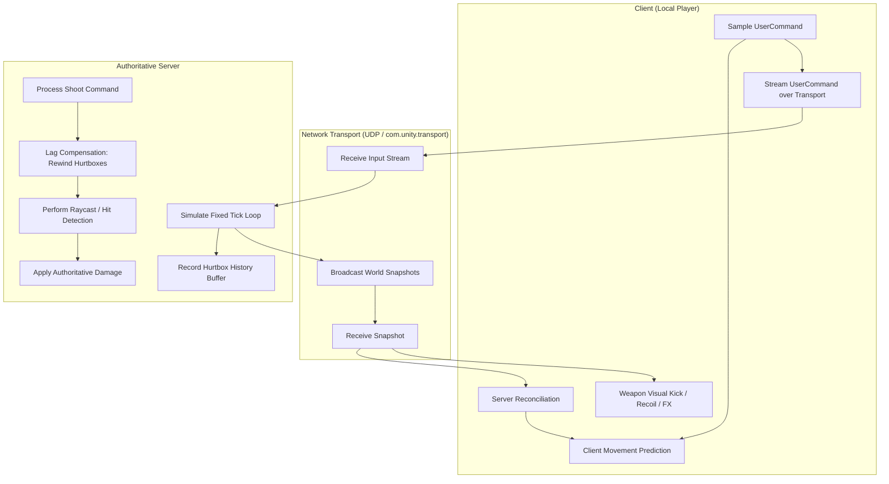

# Multiplayer FPS Architecture Guide

Architect and implement competitive, high-tick-rate, authoritative multiplayer first-person shooters in Unity, based on patterns pioneered in Unity's **FPSSample** and updated for modern **Netcode for Entities (DOTS)** and **Netcode for GameObjects (NGO)**.

---

## 1. Core Architectural Pillars

### The 4 Pillars of Competitive FPS Architecture:
1. **Server Authority with Client Prediction**: The server is the ultimate source of truth for game state and physics. The local client predicts movement and actions immediately for zero perceived input latency, reconciling backwards whenever server state diverges.
2. **Lag Compensation / History Rewind**: To ensure "what you see is what you hit," the server maintains a temporal buffer of player hurtboxes. When processing a shot from tick $T$, the server rewinds hitboxes to tick $T$, tests collision, and restores current state.
3. **Decoupled Simulation vs Presentation**: Weapon logic is split into pure deterministic simulation (ammo, rate of fire, recoil math, raycasting) and presentation (muzzle flashes, shell ejection, viewmodel animations, screen shake) driven by replicated counters (`TotalShotsCount`).
4. **Multi-Prefab Character Pipeline**: Characters are divided into specialized prefabs (First-person arms, Third-person proxy, Headless server physics, Precision hurtboxes, and Physics Ragdoll) to minimize network, CPU, and GPU waste.

---

## 2. Technical References & Deep-Dives

When designing or implementing subsystems, consult the dedicated technical guides:

- [references/netcode-prediction-rewind.md](references/netcode-prediction-rewind.md) — Comprehensive mathematical and algorithmic breakdown of client prediction, snapshot interpolation, tick loops, and history rewind lag compensation with production C# code.
- [references/weapon-systems-architecture.md](references/weapon-systems-architecture.md) — Separation of simulation from visuals, hitscan and ballistics, procedural recoil patterns, camera kickback, and network ghost synchronization.
- [references/character-rig-pipeline.md](references/character-rig-pipeline.md) — Multi-prefab character setup (First-person vs Third-person vs Server Collider vs Ragdoll), bone hierarchies, and view transform parenting.
- [references/fpssample-to-modern-dots-migration.md](references/fpssample-to-modern-dots-migration.md) — Translating FPSSample's early 2018 hybrid ECS and transport code into modern **Netcode for Entities (DOTS 1.3+)** and **Netcode for GameObjects (NGO)**.

---

## 3. Fast Implementation Checklist

### Step 1: Input & Command Sampling
- [ ] Define fixed network tick rate (e.g., 60 Hz on server, 60 Hz simulation tick).
- [ ] Sample local user inputs into a sequential, tick-stamped struct (`UserCommand`).
- [ ] Store sent `UserCommand` structs in a client ring buffer for replay during reconciliation.

### Step 2: Client Prediction & Character Movement
- [ ] Run character movement simulation immediately on the client using the latest `UserCommand`.
- [ ] Apply position/rotation directly to the local camera and character controller.
- [ ] Keep remote players on an **Interpolation Buffer** (render with an intentional delay equal to snapshot tick interval + jitter buffer, typically 50–100ms) for silky-smooth motion.

### Step 3: Server Simulation & State Snapshots
- [ ] Server validates `UserCommand` sequence and executes movement on authoritative collision colliders.
- [ ] Store transformed hurtbox capsules/boxes into a circular **History Buffer** indexed by tick.
- [ ] Compress authoritative entity transforms and broadcast delta snapshots to all clients.

### Step 4: Lag-Compensated Gunplay
- [ ] When client fires, stamp the shot packet with the exact render tick the client saw the target.
- [ ] On server, look up the target's historical hurtboxes from the History Buffer for that tick.
- [ ] Position colliders at historical positions, perform `Physics.Raycast` (or DOTS `CollisionFilter` raycast), register hits, and restore current collider transforms.

### Step 5: Decoupled Weapon Visuals
- [ ] Replicate `TotalShotsCount` (or `FireCounter`) across network.
- [ ] Locally, play muzzle flash, recoil animation, and audio immediately for the firing player.
- [ ] On remote clients, monitor `if (replicatedShots > lastSeenShots)` to trigger third-person muzzle flashes and gunshot audio without duplicating damage logic.

---

## 4. Anti-Hallucination & Architecture Traps

| Pitfall | Why It Fails | Correct Architecture |
|---|---|---|
| **Client-Authoritative Hits** | Client tells server "I hit player X for 50 damage". Allows cheat engines to send fake kill packets. | Client sends "I shot along vector V at tick T". Server validates ammo, line-of-sight, rewinds hurtboxes, and calculates damage. |
| **Physics on Headless Server** | Running full meshes, renderers, and standard character controllers on dedicated servers wastes huge CPU/GPU resources. | Dedicated server prefabs must strip all Renderers, Animators, and AudioSources, containing only simplified collision primitives. |
| **Simulating Recoil on Server Transform** | Adding procedural weapon kick directly to the character controller causes server desync and rubberbanding. | Keep weapon kickback purely cosmetic in the local viewmodel/camera offset, or simulate procedural recoil as an offset added to view angles in `UserCommand`. |
| **Rendering Remote Players without Interpolation** | Applying server snapshots directly as they arrive causes stutter and jitter due to network packet delivery variance. | Maintain a snapshot buffer and interpolate between tick $T-1$ and tick $T$ with a small interpolation delay. |
