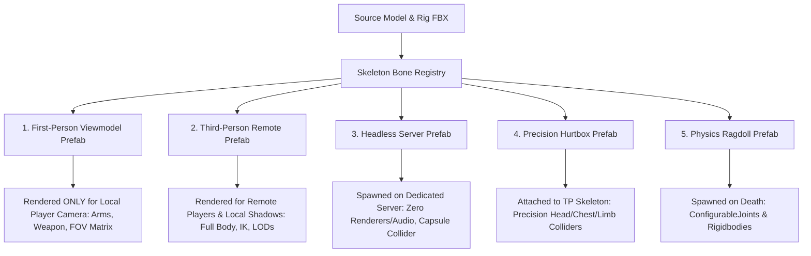

# Character Pipeline: Multi-Prefab Rig & Hierarchy Architecture

In a production multiplayer FPS (such as Unity's **FPSSample**, Call of Duty, or Apex Legends), a single monolithic character prefab cannot simultaneously satisfy the divergent demands of first-person camera clipping, third-person shadow rendering, headless server simulation, precision lag compensation, and physics ragdolls.

The solution is the **Multi-Prefab Character Pipeline**, where each character archetype is decomposed into specialized, purpose-built prefab variants.

---

## 1. The 5 Prefab Variants



### Detailed Breakdown of Prefabs

| Prefab Variant | Components Included | Stripped / Omitted | Primary Purpose |
|---|---|---|---|
| **1. First-Person Prefab** | High-poly arms/hands, weapon viewmodel, specialized FP animations, FOV camera rig | Full body mesh, lower torso, legs, heavy IK | Renders strictly on local camera. Prevents weapon/camera clipping through geometry. |
| **2. Third-Person Prefab** | Full body skinned mesh, complete skeleton, third-person animations, IK foot placement, LOD groups | First-person arms, camera attachments | Rendered for remote spectators/opponents. For local player, set to `Shadows Only` mode to cast accurate player shadows. |
| **3. Server Prefab** | Minimal character controller, bounding capsule, network ghost serializer | **ALL** SkinnedMeshRenderers, MeshFilters, AudioSources, Animators, ParticleSystems | Runs on headless Linux/Windows dedicated servers. Consumes near-zero CPU/GPU. |
| **4. Hurtbox Prefab** | Precision Box/Capsule colliders parented to Head, Neck, Spine, Pelvis, Arms, Legs | Rigidbodies, renderers | Used exclusively for bullet hit registration and server history rewind lag compensation. |
| **5. Ragdoll Prefab** | Rigidbodies, CharacterJoints / ConfigurableJoints, physical colliders | Network serializers, gameplay controllers | Instantiated dynamically upon player death to simulate natural ragdoll physics. |

---

## 2. Skeleton Component & Bone Hierarchy Lookup

In FPSSample, iterating through `transform.Find("Root/Spine/Spine1/Neck/Head")` every frame caused huge CPU overhead.
To eliminate string-based bone lookups, a dedicated `Skeleton` component caches bone transforms at import time:

```csharp
using System;
using UnityEngine;

public enum HumanoidBoneId
{
    Root,
    Pelvis,
    Spine,
    Chest,
    Neck,
    Head,
    LeftShoulder,
    LeftUpperArm,
    LeftForearm,
    LeftHand,
    RightShoulder,
    RightUpperArm,
    RightForearm,
    RightHand,
    LeftThigh,
    LeftCalf,
    LeftFoot,
    RightThigh,
    RightCalf,
    RightFoot
}

public class SkeletonRegistry : MonoBehaviour
{
    [SerializeField] private Transform[] bones = new Transform[Enum.GetValues(typeof(HumanoidBoneId)).Length];

    public Transform GetBone(HumanoidBoneId boneId)
    {
        return bones[(int)boneId];
    }

    /// <summary>
    /// Editor utility to bake bone cache automatically from Animator hierarchy
    /// </summary>
    public void BakeFromAnimator(Animator animator)
    {
        bones[(int)HumanoidBoneId.Head] = animator.GetBoneTransform(HumanBodyBones.Head);
        bones[(int)HumanoidBoneId.Chest] = animator.GetBoneTransform(HumanBodyBones.Chest);
        bones[(int)HumanoidBoneId.Pelvis] = animator.GetBoneTransform(HumanBodyBones.Hips);
        bones[(int)HumanoidBoneId.RightHand] = animator.GetBoneTransform(HumanBodyBones.RightHand);
        bones[(int)HumanoidBoneId.LeftHand] = animator.GetBoneTransform(HumanBodyBones.LeftHand);
        // ... cache remaining bones
    }
}
```

---

## 3. Viewmodel Camera Matrix & Anti-Clipping

A pervasive problem in first-person games is weapons clipping through nearby walls or objects when the player gets close.

### Production Solution: Dual-Camera Stacking or Viewmodel FOV Shader
In modern URP:
1. **Camera Stacking (Recommended)**:
   - **Base Camera**: Renders the world, environment, and remote players at standard FOV (e.g., 90°).
   - **Overlay Camera**: Positioned at identical coordinates, renders only the `FirstPersonViewmodel` layer at fixed weapon FOV (e.g., 60°) with `Clear Flags = Depth Only`.
   - **Result**: Weapons NEVER clip through world walls, and weapon proportions remain constant regardless of the player's world FOV settings.
2. **Local Third-Person Body Shadow Caster**:
   - On the local player, the third-person body mesh has its `Cast Shadows` property set to `Shadows Only`.
   - The local player sees their own shadow cast on the floor/walls by sun and spotlights, without the third-person torso geometry obscuring their first-person camera view.
