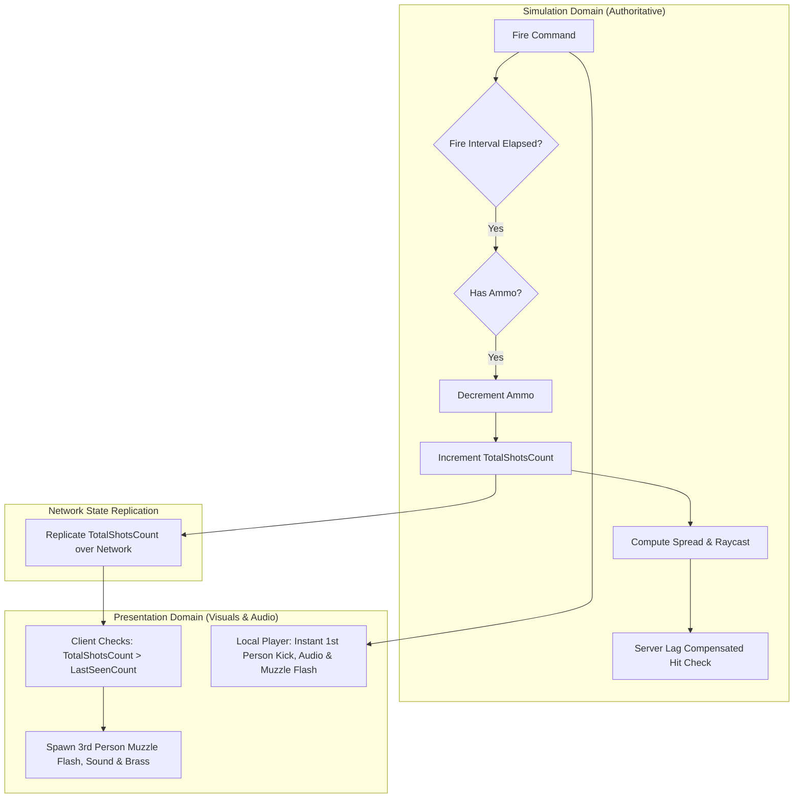

# Weapon Systems Architecture: Simulation & Presentation Decoupling

In high-performance multiplayer first-person shooters, weapon systems must be strictly divided into two distinct domains:
1. **Simulation Domain (Server & Predicted Client)**: Deterministic gameplay logic, ammo counts, fire intervals, spread dispersion, ballistic bullet physics, and lag-compensated hit verification.
2. **Presentation Domain (Local Viewmodel & Remote Proxies)**: Audio, muzzle particles, ejecting brass, dynamic lighting flashes, viewmodel procedural kickback, and camera aim punch.

This design—pioneered in games like Counter-Strike, Quake, and Unity's **FPSSample**—ensures weapons feel snappy and punchy locally while maintaining 100% server authority.

---

## 1. Architectural Separation



---

## 2. Replicated Ghost Fields

Rather than sending an RPC or network event for every single shot, the weapon state maintains a minimal set of replicated fields:

```csharp
using System;
using UnityEngine;

[Serializable]
public struct WeaponSimulationData
{
    public int ammoInClip;
    public int totalReserveAmmo;
    public uint totalShotsFired;  // Monotonically increasing shot counter
    public float nextAllowedFireTime;
    public bool isReloading;
}
```

### The Shot Counter Synchronization Technique
- Every time a shot is fired, the server and client simulation increments `totalShotsFired++`.
- The presentation system maintains a local variable `uint lastVisualShotCount = 0;`.
- On each frame:
  ```csharp
  if (weaponData.totalShotsFired > lastVisualShotCount)
  {
      int shotsToPlay = (int)(weaponData.totalShotsFired - lastVisualShotCount);
      for (int i = 0; i < shotsToPlay; i++)
      {
          PlayMuzzleEffect();
          EjectCasing();
          PlayGunshotAudio();
          ApplyViewmodelRecoil();
      }
      lastVisualShotCount = weaponData.totalShotsFired;
  }
  ```
- **Advantages**:
  - Handles packet burst or lost packets gracefully (no dropped audio/flash cues).
  - Works identically for high-rate machine guns, burst rifles, and semi-automatics.
  - Zero bandwidth overhead beyond synchronizing a single integer.

---

## 3. Procedural Viewmodel Kick & Recoil Pattern

In professional FPS games, weapon recoil consists of two components:
1. **Simulation Recoil (Crosshair / Bullet Spread)**: Shifts the actual raycast aim angle on the server.
2. **Procedural Viewmodel Kick (Spring Dynamics)**: Smoothly animates the 3D gun model backwards and rotates the barrel upwards using spring physics.

### 3.1 Damped Spring Viewmodel Recoil Controller

```csharp
using UnityEngine;

public class ViewmodelRecoilController : MonoBehaviour
{
    [Header("Spring Settings")]
    [SerializeField] private float snappiness = 20f;
    [SerializeField] private float returnSpeed = 10f;

    [Header("Recoil Kick Offsets")]
    [SerializeField] private Vector3 kickPosition = new Vector3(0f, 0.02f, -0.08f);
    [SerializeField] private Vector3 kickRotation = new Vector3(-3f, 1f, 0f);

    private Vector3 currentPosition;
    private Vector3 targetPosition;
    private Vector3 currentRotation;
    private Vector3 targetRotation;

    private void Update()
    {
        // Smoothly interpolate target back to zero resting pose
        targetPosition = Vector3.Lerp(targetPosition, Vector3.zero, returnSpeed * Time.deltaTime);
        targetRotation = Vector3.Lerp(targetRotation, Vector3.zero, returnSpeed * Time.deltaTime);

        // Spring movement to target
        currentPosition = Vector3.Lerp(currentPosition, targetPosition, snappiness * Time.deltaTime);
        currentRotation = Vector3.Lerp(currentRotation, targetRotation, snappiness * Time.deltaTime);

        transform.localPosition = currentPosition;
        transform.localRotation = Quaternion.Euler(currentRotation);
    }

    /// <summary>
    /// Call whenever a shot is fired to apply physical kickback.
    /// </summary>
    public void FireRecoil(float multiplier = 1f)
    {
        targetPosition += new Vector3(
            Random.Range(-kickPosition.x, kickPosition.x),
            Random.Range(0f, kickPosition.y),
            kickPosition.z
        ) * multiplier;

        targetRotation += new Vector3(
            kickRotation.x,
            Random.Range(-kickRotation.y, kickRotation.y),
            Random.Range(-kickRotation.z, kickRotation.z)
        ) * multiplier;
    }
}
```

---

## 4. Hitscan vs Ballistic Projectiles

Competitive shooters implement either Hitscan or Ballistic Projectiles (or a hybrid):

| Property | Hitscan (Instantaneous) | Ballistic Projectile (Simulated) |
|---|---|---|
| **Physics** | Infinite velocity raycast executed on shot frame | Parabolic trajectory with gravity, drag, and velocity per tick |
| **Use Cases** | Close/medium combat, sniper rifles, pistols, CS/Valorant style | Rockets, grenades, arrows, battlefield long-range snipers |
| **Server Cost** | Single raycast query per shot | Requires tracking entity positions and collision sweeps over time |
| **Lag Compensation** | Rewinds player hurtboxes to shot tick | Rewinds hurtboxes to bullet arrival tick at target location |

### Hitscan Raycast Origin Alignment
A common trap is raycasting directly from the visual gun barrel:
- If raycast originates from the gun barrel, players will hit obstacles when peeking corners even if their crosshair is on the enemy (known as "head-glitch" discrepancy).
- **Standard Solution (FPSSample approach)**:
  - Raycast is performed strictly from the **center of the player camera/view entity** along the camera forward vector.
  - Tracer visual particles start from the physical gun muzzle and travel toward the calculated hit impact point (`hit.point` or `ray.origin + ray.direction * 100f`).
