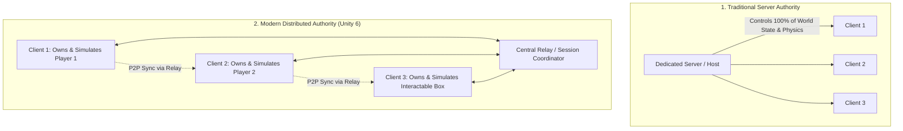

# Distributed Authority (DA) in Netcode for GameObjects

Introduced in **Netcode for GameObjects (NGO) 1.8+ / 2.0 (Unity 6)**, **Distributed Authority (DA)** is a decentralized multiplayer architecture where authority over individual `NetworkObject`s is distributed across connected clients rather than centralized entirely on a dedicated server.

---

## 1. Server Authority vs Distributed Authority



### Architectural Comparison

| Dimension | Server Authority (Host / Dedicated) | Distributed Authority (DA) |
|---|---|---|
| **Physics & Movement** | Simulated exclusively by the server | Simulated locally by the client that owns the object |
| **Hosting Costs** | High (Requires dedicated cloud servers / DGS) | **Zero to Near-Zero** (No dedicated simulation server needed) |
| **Input Responsiveness** | Requires client prediction & reconciliation | **Instantaneous local response** (Client owns authority) |
| **Cheat Vulnerability** | Very low (Server validates all actions) | Medium (Client can mutate owned objects; best for co-op/casual) |
| **WebGL Compatibility** | Complex (Requires WebSocket servers) | **Excellent** (Native peer/relay support) |
| **Best Suited For** | Competitive Shooters, MOBAs, Battle Royale | Co-op games, Social Hubs, Party games, Puzzles |

---

## 2. Using `SendTo.Authority` & `SendTo.NotAuthority`

In Distributed Authority, writing code that assumes "the server will process this" can fail because the server is merely a message relay or coordinator.
NGO solves this with the authority-agnostic RPC targets:

```csharp
using Unity.Netcode;
using UnityEngine;

public class DistributedInteractable : NetworkBehaviour
{
    // Modifiable by whichever client currently owns authority
    public NetworkVariable<int> interactionCount = new NetworkVariable<int>(
        0,
        NetworkVariableReadPermission.Everyone,
        NetworkVariableWritePermission.Owner // In DA, Owner has Write Permission!
    );

    /// <summary>
    /// Any player can call this method to request the object's authority to increment count.
    /// </summary>
    public void RequestInteract()
    {
        if (HasAuthority)
        {
            // If local client already has authority, execute directly
            interactionCount.Value++;
            NotifyInteractedNotAuthorityRpc(interactionCount.Value);
        }
        else
        {
            // Send request to the current authority holder!
            RequestInteractAuthorityRpc();
        }
    }

    // Directs the RPC to whichever client currently holds authority over this object
    [Rpc(SendTo.Authority)]
    private void RequestInteractAuthorityRpc(RpcParams rpcParams = default)
    {
        interactionCount.Value++;
        NotifyInteractedNotAuthorityRpc(interactionCount.Value);
    }

    // Broadcasts from the authority holder to all other observing peers
    [Rpc(SendTo.NotAuthority)]
    private void NotifyInteractedNotAuthorityRpc(int newCount)
    {
        Debug.Log($"Object interacted! Current count: {newCount}");
    }
}
```

---

## 3. Transferring Authority Dynamically

In Distributed Authority, an object's authority can be handed off dynamically between clients (e.g. when picking up a shared physics crate, kicking a soccer ball, or entering a vehicle):

```csharp
public class PhysicsCrate : NetworkBehaviour
{
    private Rigidbody rb;

    private void Awake()
    {
        rb = GetComponent<Rigidbody>();
    }

    public override void OnGainedOwnership()
    {
        // When this client gains authority, enable local physics simulation
        rb.isKinematic = false;
    }

    public override void OnLostOwnership()
    {
        // When losing authority, become kinematic (sync via NetworkTransform)
        rb.isKinematic = true;
    }

    private void OnCollisionEnter(Collision collision)
    {
        // If a remote player collides with this crate with higher velocity,
        // they can claim ownership to simulate the impact physics locally.
        if (collision.gameObject.TryGetComponent<NetworkObject>(out var otherNetObj))
        {
            if (otherNetObj.IsOwner && !IsOwner)
            {
                // Request ownership transfer
                RequestClaimOwnershipRpc();
            }
        }
    }

    [Rpc(SendTo.Authority)]
    private void RequestClaimOwnershipRpc(RpcParams rpcParams = default)
    {
        ulong newOwner = rpcParams.Receive.SenderClientId;
        NetworkObject.ChangeOwnership(newOwner);
    }
}
```
