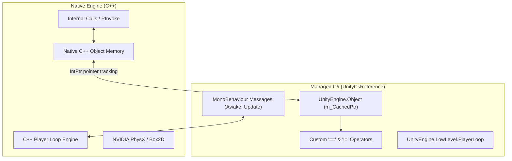

# Unity Engine Internals Guide (UnityCsReference)

Master the inner workings of the Unity Engine and Editor using insights directly from the official **`Unity-Technologies/UnityCsReference`** repository. Write cleaner, faster, bug-free C# and avoid the most common traps embedded in the native C++ / managed C# architecture.

---

## 1. Foundational Engine Mechanics

### The 4 Cornerstones of Unity's Architecture:
1. **The Native-to-Managed Split**: Almost all `UnityEngine.Object` types (`GameObject`, `Component`, `Transform`, `Material`, `Texture`) are lightweight C# wrappers pointing to unmanaged C++ memory structures via `IntPtr m_CachedPtr`.
2. **The "Fake Null" Operator**: `UnityEngine.Object` overloads `==`, `!=`, and `implicit operator bool`. When an object is `Destroy()`-ed, the native C++ object is freed, but the managed C# wrapper remains alive until the garbage collector collects it. The overloaded `== null` returns `true` because it checks `m_CachedPtr == IntPtr.Zero`.
3. **The C# Operators Trap (`?.` and `??`)**: C# 6+ null-conditional operators (`?.` and `??`) **bypass** overloaded C# operators and check pure CLR memory pointers. Calling `myComponent?.DoSomething()` or `var c = myComp ?? fallback;` on a destroyed object will fail to detect destroyed state, causing unexpected behavior or native exceptions!
4. **The PlayerLoop Engine**: MonoBehaviour lifecycle calls (`Update`, `FixedUpdate`, `LateUpdate`) are NOT invoked via reflection; they are dispatched via native function pointers mapped during script compilation into the internal `PlayerLoop`.

---

## 2. Technical References & Deep-Dives

Explore the specialized technical guides:

- [references/native-bridge-and-lifecycle.md](references/native-bridge-and-lifecycle.md) — The `m_CachedPtr` mechanics, the "fake null" problem, C# 6+ operator traps (`?.` and `??`), and garbage collection lifecycle.
- [references/player-loop-customization.md](references/player-loop-customization.md) — The native Player Loop subsystems (`EarlyUpdate`, `PreUpdate`, `Update`, `PreLateUpdate`, `PostLateUpdate`), query APIs, and inserting custom tick loops with `UnityEngine.LowLevel.PlayerLoop`.
- [references/serialization-and-editor-internals.md](references/serialization-and-editor-internals.md) — How `SerializedObject` and `SerializedProperty` track dirty flags, undo integration (`Undo.RecordObject`), property drawer layout passes, and IMGUI vs UI Toolkit internals.
- [references/zero-allocation-patterns.md](references/zero-allocation-patterns.md) — Performance patterns revealed by source inspection: `CompareTag`, `NonAlloc` physics queries, cached enumerators, avoiding boxing, and coroutine yield caching.

---

## 3. Fast Implementation Checklist

### Zero-Allocation Code Auditing
- [ ] Replace `gameObject.tag == "Name"` with `gameObject.CompareTag("Name")` (prevents string heap allocation).
- [ ] Replace `Physics.RaycastAll` with `Physics.RaycastNonAlloc` (reuses pre-allocated `RaycastHit[]`).
- [ ] Replace `GetComponents<T>()` with `GetComponents<T>(List<T>)` (reuses existing list without reallocating arrays).
- [ ] Cache `new WaitForSeconds(delay)` in private fields to prevent per-frame GC pressure in coroutines.
- [ ] Replace LINQ queries inside `Update()` with explicit loops or cached arrays.

### Null-Checking Safety
- [ ] Never use `myUnityObj?.Method()` or `myUnityObj ?? fallback`.
- [ ] Always use explicit `if (myUnityObj != null)` or `if (myUnityObj)` for any class inheriting from `UnityEngine.Object`.

### Custom Editor Architecture
- [ ] In `OnInspectorGUI`, always wrap property modifications in `serializedObject.Update()` and `serializedObject.ApplyModifiedProperties()`.
- [ ] For direct object mutations outside serialized properties, call `Undo.RecordObject(target, "Action Name")` before mutation and `EditorUtility.SetDirty(target)` after mutation.
