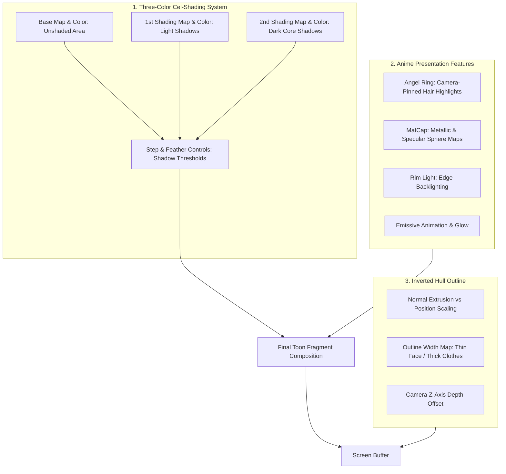

# Unity Toon Shader (UTS3) Guide

Author high-fidelity anime, cel-shaded, and stylized 3D CG graphics using the official **Unity Toon Shader** (`com.unity.toonshader`).

---

## 1. Core Architecture & Shading Layers

### The 4 Core Principles of UTS3:
1. **Designer-Defined Palette (The 3-Color Model)**: Unlike PBR shaders that compute shadows by multiplying ambient occlusion or light falloff over albedo, UTS uses three distinct artist-specified color palettes: **Base Color**, **1st Shade Color**, and **2nd Shade Color**.
2. **Step & Feather Control**: Cel-shading thresholds are tuned via numerical sliders (`Base Color Step` and `Base Shading Feather`). A low feather value produces a crisp, razor-sharp anime cel-line; a higher feather produces a soft illustrated gradient.
3. **Inverted Hull Outlines**: Generates crisp, real-time outer silhouette strokes by extruding vertex normals in a specialized backface pass. Modulated via `Outline Width Map` and camera Z-offset.
4. **Cinematic Anime Features**: Includes specialized shaders for **Angel Rings** (hair highlights that dynamically move across hair strands as the camera pans), **MatCap** (sphere reflection maps for metals and latex), and **Stencil-based eye drawing** through overlapping hair.

---

## 2. Technical References & Deep-Dives

Consult the specialized technical guides:

- [references/cel-shading-three-color-pipeline.md](references/cel-shading-three-color-pipeline.md) — The 3-color map system (Base, 1st Shade, 2nd Shade), shadow position maps, and step & feather tuning for skin, hair, and clothing.
- [references/outline-system-and-artist-tuning.md](references/outline-system-and-artist-tuning.md) — Inverted-hull outline generation, normal extrusion vs scale, outline width maps, camera Z-axis offset to fix visual artifacts, camera distance falloff, and baked normal maps.
- [references/anime-stylization-features.md](references/anime-stylization-features.md) — Angel Ring (hair ring highlight), MatCap (metallic spheres, jewelry, latex, eye reflections), Rim Lighting, Eye/Weapon Emission animation, and Scene Light vs Toon Fixed Color response.
- [references/urp-integration-and-lighting.md](references/urp-integration-and-lighting.md) — Configuring URP for Toon Shading (Forward+, shadow resolution, tone mapping considerations with ACES vs Neutral, EV adjustment, Stencil eye rendering through hair).

---

## 3. Fast Material Setup Workflow

### Step 1: Assign Shader
In the Material Inspector, set the shader to:
`Toon/Toon`

### Step 2: Configure the 3 Basic Colors
1. **Base Map (`_MainTex`) & Color (`_BaseColor`)**: Set your character's default lit color.
2. **1st Shading Map (`_1st_ShadeMap`) & Color (`_1st_ShadeColor`)**:
   - Check `Apply to 1st Shading Map` if reusing the Base Map with a darker tint, or supply a dedicated shadow map.
   - For skin, choose a warm peach or soft amber shade.
3. **2nd Shading Map (`_2nd_ShadeMap`) & Color (`_2nd_ShadeColor`)**:
   - Set the darkest core shadow (creases, occluded neck/armpits).

### Step 3: Tune Cel-Shading Step & Feather
- **Base Color Step (`_BaseColor_Step`)**: Controls how much light is needed to trigger shadows (typically 0.45–0.55).
- **Base Shading Feather (`_BaseShade_Feather`)**: Set to `0.0001` for razor-sharp anime cel-edges, or `0.05–0.15` for soft illustrated styling.

### Step 4: Configure Outlines
- In **Outline Settings**, choose `Outline Mode = Normal Direction`.
- Set `Outline Width` (typically 0.5 to 1.5).
- Enable `Blend Base Color to Outline` (0.3–0.6) so outlines match local garment colors instead of harsh stark black.

---

## 4. Anti-Hallucination & Shading Traps

| Pitfall | Why It Fails | Correct Architecture |
|---|---|---|
| **Using ACES Tonemapping with Toon Materials** | ACES tonemapping filmic curve darkens and crushes pastel anime colors into muddy grays. | In URP Volume Profile, set `Tonemapping.mode = TonemappingMode.Neutral` for anime rendering. |
| **Harsh Black Outline on Anime Face** | Pure black outlines around eyes and mouth look jarring and unnatural. | Use an `Outline Width Map` to zero-out outlines around eyes/mouth, or enable `Blend Base Color to Outline`. |
| **Inverted Hull Z-Clipping Artifacts** | Extruded outline polygons pierce neighboring geometry (fingers, chin). | Adjust `Offset Outline with Camera Z-axis` (`_Offset_Z`) to push outline geometry slightly backward in camera space. |
| **Directional Light Washes Out Cel Colors** | Intense white scene sunlight overexposes toon colors. | In **Scene Light Effectiveness Settings**, tune down light influence so the artist's color palette dominates. |
