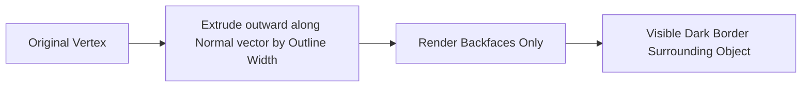

# Inverted-Hull Outline System & Artist Tuning

Outlines define the signature aesthetic of Japanese animation, manga, and cel-shaded games (such as *Guilty Gear Strive*, *Genshin Impact*, and *The Legend of Zelda: The Wind Waker*).

Unity Toon Shader implements the **Inverted Hull (Backface Extrusion)** technique to render real-time, zero-post-processing outline silhouettes.

---

## 1. How Inverted-Hull Outlining Works

```
1. Geometry Pass (Frontfaces):
   Renders standard toon-shaded front-facing polygons.

2. Outline Pass (Backfaces):
   - Inverts polygon culling (Cull Front, rendering backfaces).
   - Extrudes vertices outward along their vertex normal vector.
   - The extruded backfaces peek out behind the frontfaces, forming a clean outline!
```



---

## 2. Core Outline Controls in UTS3

### 2.1 Outline Mode (`_OutlineMode`)
* **`Normal Direction` (Recommended)**: Stretches polygons outward along vertex normals. Produces uniform, clean outlines across organic character meshes.
* **`Position Scaling`**: Scales the mesh uniformly from its local origin. Only suitable for spherical or symmetrical objects; produces skewed outlines on characters.

### 2.2 Outline Width (`_Outline_Width`)
* Controls the extrusion distance in world/model units.
* **Important**: This value depends on your 3D model's import scale. If your character was modeled in centimeters instead of meters, the default width may appear gigantic or invisible. Calibrate according to character dimensions (typically `0.5` to `1.5`).

### 2.3 Blend Base Color to Outline (`_BlendBaseColorToOutline`)
* In high-end anime, outlines are rarely pure black. Clothing has dark blue or brown outlines, hair has deep tinted outlines, and skin has soft amber outlines.
* Enabling this setting blends the adjacent **Base Color** into the outline color:
  * Value `0.0`: Solid outline color (`_Outline_Color`).
  * Value `0.5`: 50% blend between base color and outline color.
  * Result: Characters look hand-illustrated rather than computer-rendered.

---

## 3. Resolving Common Outline Artifacts

### 3.1 Eliminating Outlines from Eyes & Mouth (`Outline Width Map`)
Drawing thick outlines around eyelids, mouth interiors, or fingernails looks messy and distorted.
* **Solution**: Assign an **`Outline Width Map` (`_Outline_Sampler`)**.
* This is a linear grayscale texture:
  * **White (`1.0`)**: Full outline thickness.
  * **Gray (`0.5`)**: Half outline thickness.
  * **Black (`0.0`)**: **Zero outline!**
* Paint the eye, mouth, and nostril UV regions pure black to keep facial features crisp and clean.

### 3.2 Fixing Geometry Piercing (`Camera Z-Axis Depth Offset`)
When small features (fingers, chin, bangs) have thick outlines, the extruded backfaces can poke through neighboring front-facing geometry.
* **Solution**: Adjust **`Offset Outline with Camera Z-axis` (`_Offset_Z`)**.
* Pushes the outline geometry slightly backward along the camera's viewing ray in clip space, resolving Z-fighting and geometry clipping without altering the outer silhouette.

### 3.3 Distance-Based Outline Scaling
Without distance falloff, outlines on distant characters appear disproportionately thick, turning the character into a solid dark blob.
UTS provides distance scaling parameters:
* **`Nearest Distance to draw with Outline Width` (`_Nearest_Distance`)**: Minimum camera distance where outline stays at max width.
* **`Farthest Distance to vanish` (`_Farthest_Distance`)**: Distance at which outline fades to zero thickness.

---

## 4. Baked Normal Maps for Hard Surfaces

On low-poly or hard-surface meshes (armor plates, weapons, mechanical props), sharp 90-degree creases split vertex normals, causing the extruded outline to split open and produce ugly gaps:

```
Un-baked Normals:
    /|   <-- Gap / tear in outline at sharp corners!
   / |
  /  |
```

* **Solution**: Use **`Baked Normal Map` (`_BakedNormal`)**.
* Smooth vertex normals can be calculated in Blender/Maya and baked into a dedicated UV texture. When loaded into UTS, the outline extrudes along the smooth baked normals, maintaining seamless silhouette loops across sharp mechanical edges.
