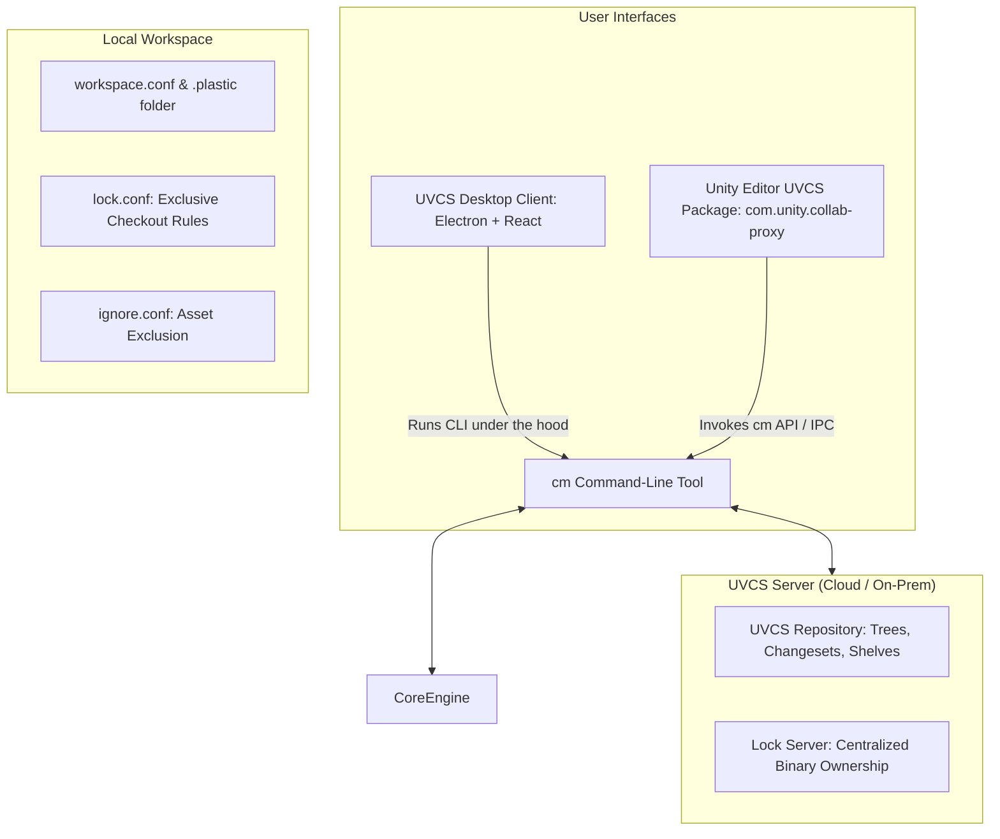

# Unity Version Control (UVCS) & Desktop Client Guide

Master **Unity Version Control (UVCS)** (formerly Plastic SCM) and its open-source **Desktop Client** (`uvcs-desktop-client`). Manage massive game repositories, large binary assets, exclusive checkouts, branching, and automated `cm` CLI workflows.

---

## 1. UVCS Architecture & Components



### The 4 Pillars of UVCS:
1. **Engineered for Game Development**: Designed specifically to handle terabytes of binary assets (textures, 3D models, audio, video) alongside source code without the performance bottlenecks of Git LFS.
2. **The `cm` CLI**: The foundational command-line interface executable that powers both the official desktop clients and the Unity Editor integration.
3. **Exclusive Checkout (`lock.conf`)**: Prevents merge conflicts on unmergeable binary assets (scenes `.unity`, prefabs `.prefab`, `.fbx`, `.psd`, `.png`) by locking the file on the server when an artist begins editing.
4. **The Desktop Client (`uvcs-desktop-client`)**: An open-source, modern desktop client built with Electron, React, TypeScript, and `electron-vite`, featuring the famous Branch Explorer, 3-way merge visualizer, shelves, and code reviews.

---

## 2. Technical References & Deep-Dives

Explore the specialized technical guides:

- [references/cm-cli-reference.md](references/cm-cli-reference.md) — Complete `cm` CLI command cheatsheet: workspace creation, status inspection, checkin, branch switching, merging, locking, and shelving.
- [references/locking-and-ignore-configuration.md](references/locking-and-ignore-configuration.md) — Production configurations for `lock.conf` (binary locking) and `ignore.conf` (excluding Library, Temp, obj, Build artifacts) with `.meta` file integrity rules.
- [references/uvcs-desktop-and-editor-workflow.md](references/uvcs-desktop-and-editor-workflow.md) — Anatomy of `uvcs-desktop-client`, Unity Editor integration (`com.unity.collab-proxy`), Branch Explorer navigation, and code review workflows.
- [references/uvcs-vs-git-lfs-comparison.md](references/uvcs-vs-git-lfs-comparison.md) — Comprehensive technical comparison: UVCS (Plastic SCM) vs Git + Git LFS for game studios (performance, storage scaling, branching, and artists workflows).

---

## 3. Fast Implementation Checklist

### Step 1: Workspace & Ignore Setup
- [ ] Ensure `ignore.conf` exists at workspace root excluding `[Ll]ibrary/`, `[Tt]emp/`, `[Oo]bj/`, `[Bb]uild/`, `[Bb]uilds/`, and `*.csproj`.
- [ ] Configure `lock.conf` on the server or workspace root to auto-lock `.unity`, `.prefab`, `.mat`, `.fbx`, `.psd`, and `.png` on checkout.

### Step 2: Essential CLI Operations
```bash
# Check status of changed files
cm status --short

# Pull latest changesets from current branch
cm update

# Check in pending changes with a descriptive comment
cm checkin -c="Add character jump mechanics and input binding"

# Create and switch to a task feature branch
cm branch create br:/main/task-player-controller
cm switch br:/main/task-player-controller
```

### Step 3: Meta File Discipline
- [ ] Every asset in `Assets/` MUST have an accompanying `.meta` file checked in with the exact same changeset.
- [ ] Never delete an asset without also deleting its `.meta` file.
- [ ] Never check in an asset without its `.meta` file (causes missing GUID references on teammate machines).

---

## 4. Anti-Hallucination & Workflow Traps

| Pitfall | Why It Fails | Correct Architecture |
|---|---|---|
| **Committing Assets without `.meta` Files** | Teammates receive broken references, missing textures, and magenta materials because GUIDs are missing. | Always commit assets and their `.meta` files together in the exact same changeset. |
| **Two People Editing a `.unity` Scene File** | Unity scene files are YAML/binary structures that frequently corrupt during manual merges. | Add `*.unity` to `lock.conf`. The first person to edit acquires an exclusive lock; others must wait until check-in. |
| **Checking in `Library/` or `Temp/`** | `Library` contains machine-specific cache files that cause gigabytes of repository bloat and cache corruption. | Always maintain a strict `ignore.conf` ignoring `Library/`, `Temp/`, and build artifacts. |
| **Editing Files Outside Workspace** | `cm` tracks files relative to `workspace.conf`. Files outside the workspace directory will not be detected or tracked. | Keep all game assets strictly inside the designated workspace root. |
