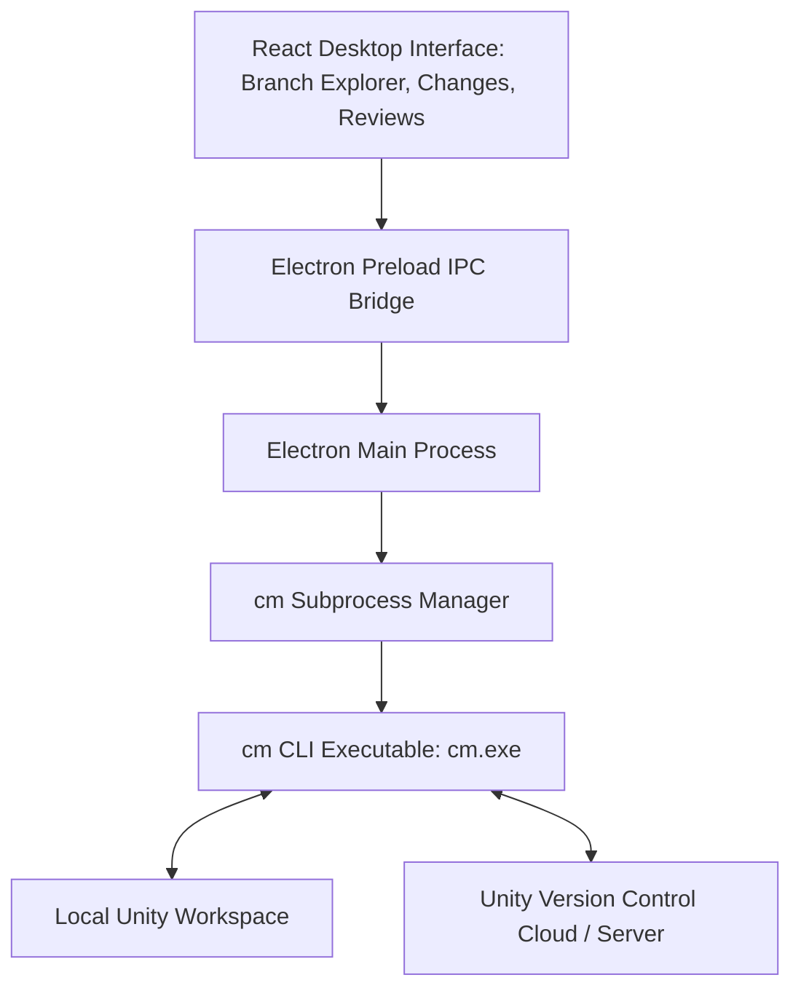

# UVCS Desktop Client & Unity Editor Integration

This reference explains the internal architecture of the open-source **`uvcs-desktop-client`** and how it interfaces with the Unity Editor integration package (`com.unity.collab-proxy`).

---

## 1. Anatomy of `uvcs-desktop-client`

The **`Unity-Technologies/uvcs-desktop-client`** is built with a modern web/desktop stack:
- **Electron**: Provides cross-platform desktop shells for macOS, Windows, and Linux.
- **React & TypeScript**: Powers the high-performance component UI.
- **`electron-vite`**: Enables fast HMR, TypeScript bundling, and dual main/renderer compilation.
- **`cm` CLI Subprocess Driver**: The client does not implement custom network protocol logic; it executes `cm` commands in child processes, parsing `--format=json` or structured output.

---

## 2. Key Desktop Client Features

### 2.1 The Branch Explorer
The defining feature of UVCS is the **Branch Explorer**:
- Visualizes repository history as an interactive topological graph rather than a flat linear log.
- Displays branches, sub-branches, merges, cherry-picks, and release labels (`v1.0`, `Milestone-2`).
- Renders repositories with hundreds of thousands of changesets at 60 FPS using GPU-accelerated canvas rendering.
- Right-click any branch or changeset to:
  - Create a new task branch.
  - Switch workspace to that branch.
  - Merge into current branch.
  - Create a Code Review.

### 2.2 Pending Changes & Integrated Diff
- Lists all modified, added, deleted, moved, and private files.
- Provides a side-by-side graphical diff viewer for code, text, and shader files.
- Visual image diffing for textures (`.png`, `.psd`, `.jpg`) with slider swipe comparisons and difference heatmaps.
- In-diff inline editing allows quick fixes before check-in.
- Shelving allows storing incomplete work on the server without creating a formal changeset.

### 2.3 Built-in Code & Asset Reviews
- Create code reviews directly on a changeset or branch.
- Leave line-by-line comments, suggest edits, and approve/reject branches before merging to `/main`.

---

## 3. Unity Editor Integration (`com.unity.collab-proxy`)

Unity integrates UVCS directly into the Editor interface via the **Version Control** package (`com.unity.collab-proxy`):

### 3.1 Editor Status Glyphs (Project Window)
In the Unity Project and Hierarchy windows, assets display real-time status icons:
- **Green Checkmark**: Controlled and up to date.
- **Blue Checkmark**: Checked out / modified locally.
- **Yellow Plus**: New asset added locally (needs check-in).
- **Lock / Padlock**: Exclusively locked on the server by another teammate.

### 3.2 In-Editor Workflows
- **Window > Version Control**: Opens the in-editor UVCS panel to inspect pending changes, view diffs, write commit messages, and check in without alt-tabbing to an external app.
- **Automatic `.meta` File Synchronization**: When you move or rename an asset in the Unity Project window, the editor plugin automatically schedules both the asset and its accompanying `.meta` file for moving/renaming in UVCS.
